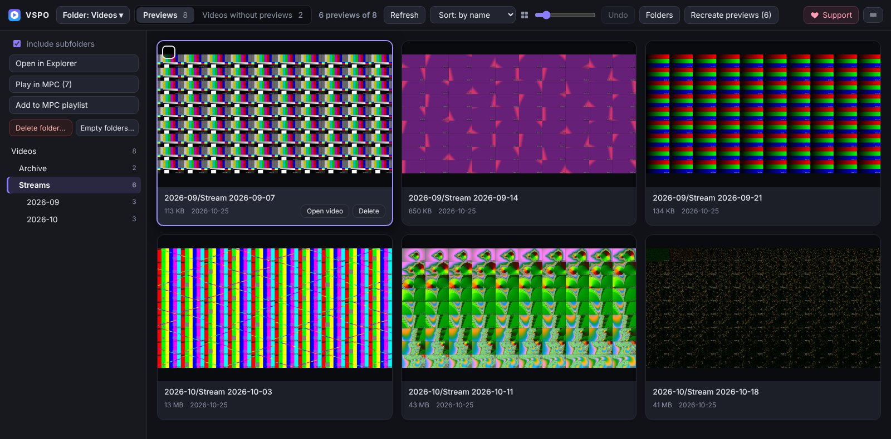
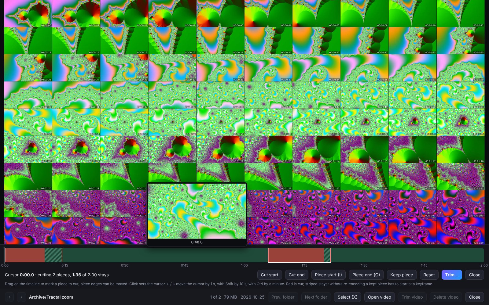

# VSPO — Video Streams Preview Organizer

A Windows desktop tool for browsing, cleaning up and trimming large video collections (stream recordings, archives on a NAS) through their **contact sheets** — preview images with a grid of timestamped frames.

It walks a folder and its subfolders, matches every video with its preview image by name, and shows the previews as a gallery. From there you can delete videos (together with their previews), generate missing previews with ffmpeg, trim videos losslessly, and send videos to MPC-HC — without opening each file.

The whole program is a single Python file (`pairview.py`, standard library only). The UI is a local web page served on `127.0.0.1` and shown in its own window (pywebview / WebView2) or in a browser. The interface is in English.



## Features

- **Gallery of previews.** Matches `clip.mp4` with `clip.jpg` (or `clip.mp4.jpg`) in the same subfolder. Folder tree with counters, sorting, adjustable tile size, full-screen viewer, keyboard navigation that crosses folder boundaries.
- **Safe deletion.** "Delete" never erases anything: the video and its preview are moved (renamed, never copied) into `_to_delete` inside the root folder (an old `_на_удаление` folder from earlier versions is treated the same way). `Ctrl+Z` brings them back. Permanent deletion is a separate, explicit action. Works for single videos, selections, whole folders and empty folders.
- **Preview generation.** Creates missing contact sheets with ffmpeg: a 10×9 grid, 2560 px wide, with an `HH:MM:SS` timestamp on every frame (vertical and short videos get adapted grids). Frames are grabbed in batches of ~30 per ffmpeg run, because launching ffmpeg on Windows is expensive. Several videos are processed in parallel; the queue can be stopped at any time.
- **Lossless trimming.** In the viewer, press `C` to open a timeline under the preview. Mark parts to remove — the beginning, the end, or any number of pieces in the middle — by dragging on the timeline or with `I`/`O` at the cursor. Hovering the timeline instantly shows the matching frame from the contact sheet, then the exact frame from ffmpeg. The video is cut with stream copy (no re-encoding, seconds even for long files); each kept piece starts at the nearest earlier keyframe, so nothing you keep is lost. The original goes to `_to_delete`, the trimmed file takes its place, the preview is regenerated, and `Ctrl+Z` restores the original together with the old preview.

  

- **MPC-HC integration.** Play a folder, a selection or a single video in MPC-HC / MPC-BE, or append them to the playlist without starting playback. Show any file in Explorer.
- **Folder switching.** The last opened folder reopens automatically; another one can be picked from the header (recent folders or a folder dialog) without restarting.
- **Updates from GitHub.** The menu (☰) checks for a new release; one click downloads it, replaces the exe and restarts VSPO with the same folder. A green dot on the menu button means an update is available.
- **Network-friendly. Built for videos on an SMB share: no repeated directory walks in request handlers, the trash counter is kept in memory, preview images are read once and closed immediately.

## Requirements

- Windows 10 or 11.
- Python 3.8+ (to run from source). Only the standard library is needed.
- Optional: [`pywebview`](https://pywebview.flowrl.com/) for the app window (uses Microsoft Edge WebView2). Without it the gallery opens in the default browser.
- Optional: [`ffmpeg` and `ffprobe`](https://ffmpeg.org/) for creating previews and trimming. Found via `--ffmpeg`, next to the program (also in `ffmpeg\`, `ffmpeg\bin\`, `bin\`), or in `PATH`.
- Optional: MPC-HC or MPC-BE (the K-Lite Codec Pack location is detected automatically).

## Usage

```bat
pip install pywebview
python pairview.py "D:\Videos"
```

Run without a folder argument to reopen the last folder (or get a folder picker on first start). `pythonw.exe pairview.py ...` runs without a console window; the log then goes to `%APPDATA%\pairview\pairview.log`.

Common options:

| Option | Meaning |
|---|---|
| `folder` | Root folder with videos (and previews, if they are stored together) |
| `--previews DIR` | Separate root for previews with the same subfolder layout |
| `--ffmpeg PATH`, `--font PATH` | ffmpeg location (file or folder), `.ttf` font for timestamps |
| `--player PATH` | Path to `mpc-hc64.exe` / `mpc-be64.exe` |
| `--cols 10 --rows 9 --width 2560 --header` | Contact sheet layout; `--header` adds file info on top |
| `--jobs N`, `--gpu auto\|on\|off`, `--per-frame` | Parallel videos, NVDEC decoding, one ffmpeg run per frame |
| `--ignore-ext ts` | Video extensions to ignore (default: `.ts` stream fragments) |
| `--clean videos\|previews [--apply]` | List or move videos without previews / previews without videos, no UI |
| `--purge` | Permanently delete everything in `_to_delete` (asks for confirmation) |
| `--browser`, `--no-browser`, `--port N` | Use a browser instead of the window, server only, fixed port |

Persistent options can be put into `pairview.json` next to the program or in `%APPDATA%\pairview`, using option names without dashes:

```json
{"folder": "D:\\Videos", "player": "C:\\Program Files\\MPC-HC\\mpc-hc64.exe", "ignore_ext": "ts"}
```

### Keyboard

| Where | Keys |
|---|---|
| Gallery | Arrows, `Home`/`End` — select; `Space` — full screen; `Enter` — open video; `E` — show in Explorer; `Del` — delete video(s); `[` `]` `PgUp` `PgDn` — previous/next folder; `X`, `Ctrl+A` — select tiles; `Ctrl+Z` — undo; `F5` — rescan |
| Viewer | `←`/`→` — previous/next; `C` — trim video; `I` — hide the bottom bar; `Esc`/`Space` — close |
| Trimming | `←`/`→` — move cursor 1 s (`Shift` 10 s, `Ctrl` 1 min); `I`/`O` — start/end of a piece to remove; `Del` — unmark the selected piece; `Esc` — close |

## Building a standalone exe

GitHub Actions builds `VSPO.exe` on every push (workflow **Build exe**, also runnable by hand): download it from the run's **Artifacts**. Pushing a tag like `v1.1`, or running the workflow by hand with a tag in the **release** field, also publishes the exe as a GitHub release. The tag must match `VERSION` in `pairview.py` (the build checks it): that is how the in-app updater compares versions. To build locally on Windows:

```bat
pip install pyinstaller pywebview
pyinstaller --onefile --noconsole --name VSPO --icon assets/vspo.ico --collect-all webview --collect-all pythonnet --collect-all clr_loader pairview.py
```

The result is a single `dist\VSPO.exe`. ffmpeg is not bundled: put `ffmpeg.exe` and `ffprobe.exe` next to the exe or in `PATH`.

## Notes

- Only `127.0.0.1` is used. Every request needs a random token generated at start-up; paths coming from the page are never trusted (videos are referenced by id, folders are checked to stay inside the root).
- Trimming copies the first video stream and all audio streams; subtitles and other streams are not carried over.
- The screenshots use synthetic test videos generated by ffmpeg (test patterns, fractals, Game of Life).
- Developer notes (architecture, data model, pitfalls) are in [`CLAUDE.md`](CLAUDE.md), in Russian.

## Support

VSPO is free. If it saves you time, you can support its development:

- [Monobank jar](https://send.monobank.ua/jar/6m4nBQCW9B) (card of any bank)
- [Ko-fi](https://ko-fi.com/commonfool)
- [Crypto (NOWPayments)](https://nowpayments.io/donation/commonfool)

## License

[MIT](LICENSE)
